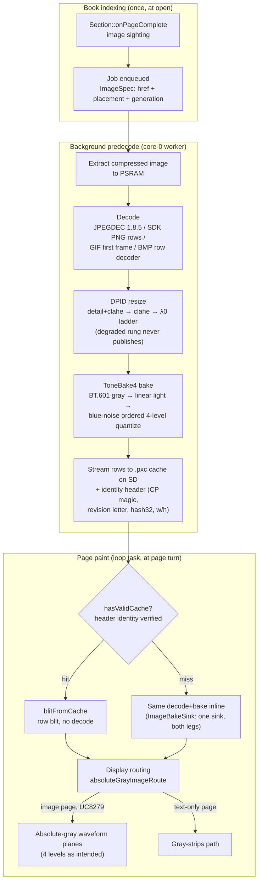

# ADR: X4 Pro Image Pipeline — Blue-Noise Tone Bake in Linear Light

Date: 2026-11-25
Author: Antoine Aflalo (Belphemur)
Status: Accepted (as-built; verified against develop at `db2c7319` + the pinned freeink-sdk)

**Supersedes** the whole TTF image design chain — their decisions are folded here;
the files stay as the history of *why* each call was made:

| Superseded doc | What it contributed that survives here |
|---|---|
| `2026-11-07-ttf-image-engine.md` | Predecode worker architecture, format parity set, cache identity |
| `2026-11-08-ttf-image-grayscale-quality.md` | Display routing: image pages ride the absolute-gray waveform |
| `2026-11-08-ttf-image-contrast-and-fit.md` | Full-fit placement in logical coordinates; adaptive stretch findings |
| `2026-11-08-ttf-image-texture-quality.md` | Flat-field defects; replaced by the stateless ordered bake |
| `2026-11-08-ttf-image-text-in-image.md` | Its per-pixel edge pass was **dropped** (§ Non-goals); sharpening belongs before the bake |
| `2026-11-09-ttf-image-blockiness.md` | Bake-side rebuild verdict: diffusion contracts replaced wholesale |
| `2026-11-09-ttf-image-dpid-clahe.md` | DPID front end; CLAHE (now off by default) |
| `2026-11-20-cover-image-pipeline.md` | Shared bake core (`lib/ImageBake`), cover/thumbnail/sleep surfaces |

What dies with them: ToneBake4 as a wrapper around error-diffusion quantizers
(Atkinson cutoff/targets, Floyd–Steinberg row state), the position-dependent
cache contract (Bayer absolute outX/outY, diffusion row state), the
picture-quality settings surface, and every per-defect bake constant the soak
chases accumulated (stroke anchors, snap thresholds, diffusion weights).

## TL;DR — the pipeline in plain words

An e-ink panel this cheap can show only **4 levels of gray** (white, light
gray, dark gray, black) — it cannot show a photo, only a clever black-and-white
dot pattern that *looks* like one from reading distance. Everything in this
design is about choosing that dot pattern well, and choosing it **before** you
turn the page so you never wait for it.

The flow, in one breath:

1. **While you read, a background worker prepares ahead.** It takes the
   images coming up in the next pages, decodes them (JPEG/PNG/GIF/BMP — all
   handled), shrinks them to fit the screen without losing the thin lines
   (DPID), and converts each pixel into one of the 4 gray levels using a
   fixed "blue-noise" dot pattern that looks like film grain instead of
   checkerboard noise.
2. **The result is saved to the SD card** as a small cache file (`.pxc`,
   ~2 bits per pixel), stamped with a fingerprint of what produced it.
3. **When you actually turn to that page, the device just copies the saved
   pattern to the screen** — near-instant, no decoding, no waiting. If the
   cache is missing or stale (fingerprint mismatch), it is thrown out and
   rebuilt; you pay the cost once, invisibly.
4. **The screen shows the 4-level pattern through a special gray waveform**
   so the levels actually appear as intended instead of collapsing to black
   and white.

Why these choices:

- The **dot pattern (blue-noise ordered dither)** won a blind voting
   tournament the owner ran against every alternative — the previous
   approaches (error-diffusion dithering) had to carry "correction state"
   from pixel to pixel, which caused wash-outs, checkerboards, and made it
   impossible to guarantee two different code paths produced identical
   files. The winner has no state at all: same input → same output,
   everywhere, every time.
- The **resize step (DPID)** comes *before* the dot pattern on purpose:
   resizing is what keeps thin strokes (text inside illustrations) intact;
   applying effects after the dot pattern is painted destroys it.
- **One JPEG decoder (JPEGDEC, vendored into the SDK)** instead of two
   half-maintained ones — decoder bugs are fixed once, where tests run.
- The **same cache format and fingerprinting serves everything**: book page
   images, the cover on your sleep screen, the Continue-Reading thumbnail.
   A file with the wrong fingerprint is never trusted.

If you remember one thing: **background prep → one high-quality dot pattern →
instant blit at page turn**, and any "image looks bad" report is checked
against the *display route* before anyone touches the pattern.

## Mermaid diagram of the pipeline

## 1. Context

The X4 Pro renders EPUB images on a 480×800, 4-level e-ink panel (UC8279
controller). Three problems made the pre-battle pipeline unacceptable:

1. **Speed.** First view of an image page decoded synchronously on the loop
   task — measured 3.5–4.5 s stalls (DanMachi vol-01 soak, 2026-11-07).
2. **Quality.** Soak after soak returned washed-out mid-tones, checkerboard
   flat fields, blocky bands, and dither-fragmented text inside illustrations.
   Each fix was a patch on a diffusion-based bake whose row-carried error
   state made output depend on decode order, screen position, and previous
   rows — so worker/foreground caches could never be guaranteed identical.
3. **Evidence.** The quality calls had no arbiter: offline optimizers and
   device renders disagreed, and tuning cycles (293 rounds of bake constants
   chased by soak) kept regressing one defect while fixing another.

The decision mechanism was a **blind A/B battle** (`eink-blind-battle`,
self-hosted at :8090): a panel-accurate linear-light simulation of the X4 Pro,
every candidate algorithm on the same shared front end, forced-choice voting
with identities hidden until the vote is cast, parity-tested doubles of the
firmware's own algorithms (byte-for-byte against the repo headers). The owner
voted over the corpus until done: **the blue-noise ordered dither in linear
light won 11–0 vs the Atkinson bake and 8–0 vs the legacy engine**. That
verdict — not parity with any previous rendering — is the acceptance bar.

## 2. Decision

### 2.1 One tone bake: `ToneBake4` — 64×64 void-and-cluster blue noise, ordered, linear light

`src/activities/reader/TtfImageCache.h` (`ToneBake4`), tables in
`lib/ImageBake/BlueNoise64.{h,cpp}`:

- **Domain:** decode to 8-bit BT.601 gray, then to **linear light**
  (`v = 255·(g/255)^2.2`) before quantizing. The bake thresholds against the
  panel's four nominal reflectances {0, 85, 170, 255} — exactly what the panel
  renders — so the bake's mean reflectance equals the image's mean
  reflectance. Gamma-domain tone mapping (the old brightening LUT) collapsed
  midtones into the two lightest levels on a 4-level path and is not used.
- **Dither:** ordered, thresholded by the 64×64 toroidal void-and-cluster
  **blue-noise** matrix (`kBlueNoise64[y & 63][x & 63]`), quantized through
  the precomputed integer LUT `kBlueNoiseLinearLut` — zero float, zero
  divide, zero branch on the hot path, zero heap (`sizeof(ToneBake4) <= 32`,
  static_assert). The ESP32-S3 fast path `toneRow()` hoists the 64-byte noise
  row and steps in 64-px tiles.
- **Statelessness is the point.** No error carries between pixels or rows, so
  output is a pure function of (x, y, gray): worker and foreground produce
  **byte-identical caches by construction**, placement and rotation never
  shift the tone, and the single-pass DPID stream can feed the bake row by
  row. This is the structural reason the ordered bake won over every
  diffusion candidate, beyond the visual verdict.

### 2.2 Resize first: DPID detail-preserving downscale, with a drop ladder

`lib/ImageBake/DpidScaler.{h,cpp}` — Nehab's rapid detail-preserving
resampling (λ=1 second pass), streaming, fixed cost: the feasible MCU
replacement for the box-average that smeared thin strokes. A scratch-budget
ladder degrades on PSRAM exhaustion — `detail+clahe → clahe → λ0` — and a
degraded rung never publishes a cache (the partial file is removed; the next
view re-decodes). **CLAHE is OFF by default** (owner decision, 2026-11-13);
the detail pass is always on.

### 2.3 One JPEG front end: vendored JPEGDEC in the SDK

All JPEG modes (baseline, progressive, DC fallback) decode through JPEGDEC
**1.8.5, pinned as a git submodule of freeink-sdk** (FreeType pattern);
TJpgDec and the app-side device patches are gone, and firmware carries no
second copy. Decoder fixes belong in the SDK: progressive tile-assembly
corruption and the ZipCatalog seek state landed there (`838986e`, `3f7b95a`)
with bit-exact host tests. PNG rides the SDK row decoder; GIF (first frame)
through `GifToFramebufferConverter`'s PSRAM entry; BMP through a dedicated
app-side row decoder (DIB core/info headers, 1/4/8/24/32 bpp BI_RGB, RLE
refused, bounded DIB-height negation).

### 2.4 The shared bake core — one sink, every pixel surface

`lib/ImageBake/` is the spec-independent core, shared by reader pages, cover
images, home thumbnails, and sleep art: `ImageBakeCache.h` (the on-disk 2-bit
`.pxc` format + identity header), `ImageBakeQuantizer.h` (the quantizer,
pinned bit-exact against the reader bake including the 64-px tile seam),
`ImageBakeSink.h` (the single-pass row sink: `toneRow → cache row → paint`),
`CoverCache` (one combined identity-headered file with self-contained 1-bit
thumb + 2-bit cover sections, opened through `HalStorage::openFileSubview`).
Every BMP-producing converter opts in via the `BmpStreamWriter::begin` bake
enum, whose default stays Legacy so hash-named caches never drift silently.

### 2.5 Cache identity: headered `.pxc`, validated on every open

`.pxc` = 2 bits/pixel (4 levels), header = magic `'C','P'` + bake revision
letter + top 32 bits of the FNV-1a identity hash + w/h u16. Identity =
full `ImageSpec` (layout generation + href + placement + tone policy).
Verified on **every** open path; a file that fails is **removed** so the next
view re-decodes — a stale or torn payload can never serve under a live name.
Bake-math changes bump the revision letter (stale caches regenerate once — a
one-time cold wave, not a bug). Scope of the guarantee: identity + dims, not
payload bytes.

### 2.6 Predecode: background worker, paint consumes the cache

`ImagePredecodeWorker.{h,cpp}` (core-0 worker, priority 1, gated
`BOARD_HAS_PSRAM && CROSSPOINT_TTF_READER`; inert stub on C3): jobs enqueued
from `Section::onPageComplete` sightings, decoding upcoming images into `.pxc`
caches ahead of the paint. Compressed bytes live only in PSRAM; SD receives
only the processed cache. The foreground paint (`QuickPageRelayout.cpp`) is
cache-first — `hasValidCache` → `blitFromCache` (row blit, no decode) — with
the identical decode as fallback, through the same `ImageBakeSink`, so both
legs are byte-identical by construction.

### 2.7 Display routing: baked tone deserves the absolute-gray waveform

A bake can be perfect and still be destroyed by display routing: the
predicate `absoluteGrayImageRoute` (pure, in `TtfImageCache.h`, fed by
`ttfAbsoluteImageGray` in `QuickPageRelayout.cpp`) sends image pages to the
UC8279 absolute-gray planes; text-only pages keep the gray-strips path.
Triage rule, unchanged: any "washed-out image" complaint is a routing question
before it is a bake question.

### 2.8 Settings: bake always on, one revert switch

The picture-quality setting is removed — the blue-noise bake is the only
reader-page path. `imageDecodeQuality` (default ON) is the single revert
switch back to the retained reference bake (`FloydSteinberg4`, kept for A/B
on device); CLAHE stays off by default and is re-enabled only by an ADR
amendment.

## 3. Why this shape (the reasons, compressed)

- **Blind verdict over corpus:** the owner's tournament replaced argument
  with data; the winner is the bake, not a heuristic we defend.
- **Statelessness buys correctness for free:** identical worker/foreground
  output, position independence, single-pass streaming with DPID, and no
  checkerboard-equilibrium failure modes — every structural defect class of
  the diffusion bakes is eliminated rather than patched.
- **Linear light maps to what the panel does,** not to a perceptual ideal the
  4-level panel cannot express.
- **DPID preserves strokes** through the resize, where box-average smeared
  and sharpen-after-resize amplified aliasing.
- **One SDK JPEG front end** ends the two-decoder era and moves fixes to
  where tests can run (SDK host suites, 64k checks green).
- **Shared bake core with identity headers** made covers/thumbs/sleep art and
  the reader one format, and made torn/stale caches unserveable.

## 4. Consequences

- Positive: warm first-view image pages (worker predecode), one quality bar
  across every pixel surface, deterministic caches, decoder bugs fixable in
  the SDK.
- Cost: every bake-math change bumps the revision letter and forces a
  one-time re-decode wave across all users' caches.
- Gates that keep this honest: host suites `test/image_bake` (bit-exact
  quantizer parity incl. the 64-px seam + 1-bit contract),
  `test/ttf_image_engine`, `test/ttf_image_fit`, `test/psram_image_staging`;
  `pio run -e x4pro` and `-e default` (C3 floor compiles the feature out);
  cppcheck gate. The battle app remains the arbiter for any future bake
  change: new candidates re-run the tournament before firmware changes.

## 5. Non-goals

- SVG/WebP: refused at layout, as before.
- Animated GIF: first frame only.
- CLAHE on by default, or any sharpen-after-dither pass (the text-in-image
  edge pass was tried and dropped: post-dither pixel classification
  posterizes gradients; sharpening belongs before the bake, and the
  DPID detail pass already carries it).
- 8-bit grayscale output: the panel is 4-level; richer tone is a waveform
  concern, not a cache-format one.
- Retiring the legacy quantizer code: it stays behind the revert switch.
